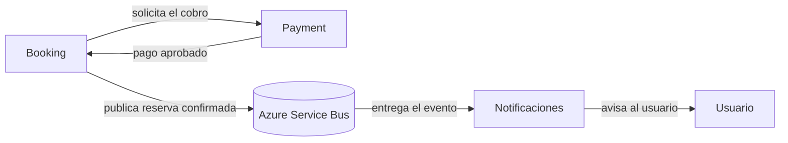

# Diseño inicial del servicio de Notificaciones

## Propósito

Notificaciones informa al usuario que su reserva fue confirmada después de que
Payment haya aprobado el cobro. La consigna pide agregar este servicio al diseño,
pero no implementarlo en código.

## Flujo propuesto

1. Booking procesa la solicitud y obtiene el resultado exitoso del pago desde
   Payment.
2. Booking confirma la reserva y publica un evento de reserva confirmada en Azure
   Service Bus.
3. Notificaciones se suscribe a ese evento y envía el aviso al usuario por el
   canal que el equipo defina.

El diagrama es conceptual: el nombre exacto de la cola o del tópico, el formato del
evento y el canal de notificación todavía deben acordarse. No representa una
integración ya implementada.

## Responsabilidades y límites

- **Booking** sigue siendo responsable del estado de la reserva y publica la
  confirmación una vez que el pago tuvo éxito.
- **Notificaciones** recibe la confirmación y comunica el resultado; no decide si
  el asiento está disponible ni procesa pagos.
- Si el pago falla, no se debe emitir una notificación de reserva confirmada.
- La notificación es asíncrona: la confirmación del pago y de la reserva no debe
  depender de que el usuario reciba el aviso en ese mismo instante.

Este flujo tiene una ventana de consistencia eventual: Booking puede confirmar la
reserva antes de que Notificaciones procese el evento y avise al usuario. Los
detalles de reintentos, entregas duplicadas y canal de envío quedan para el diseño
de integración del equipo; no se implementan como parte de este componente.
